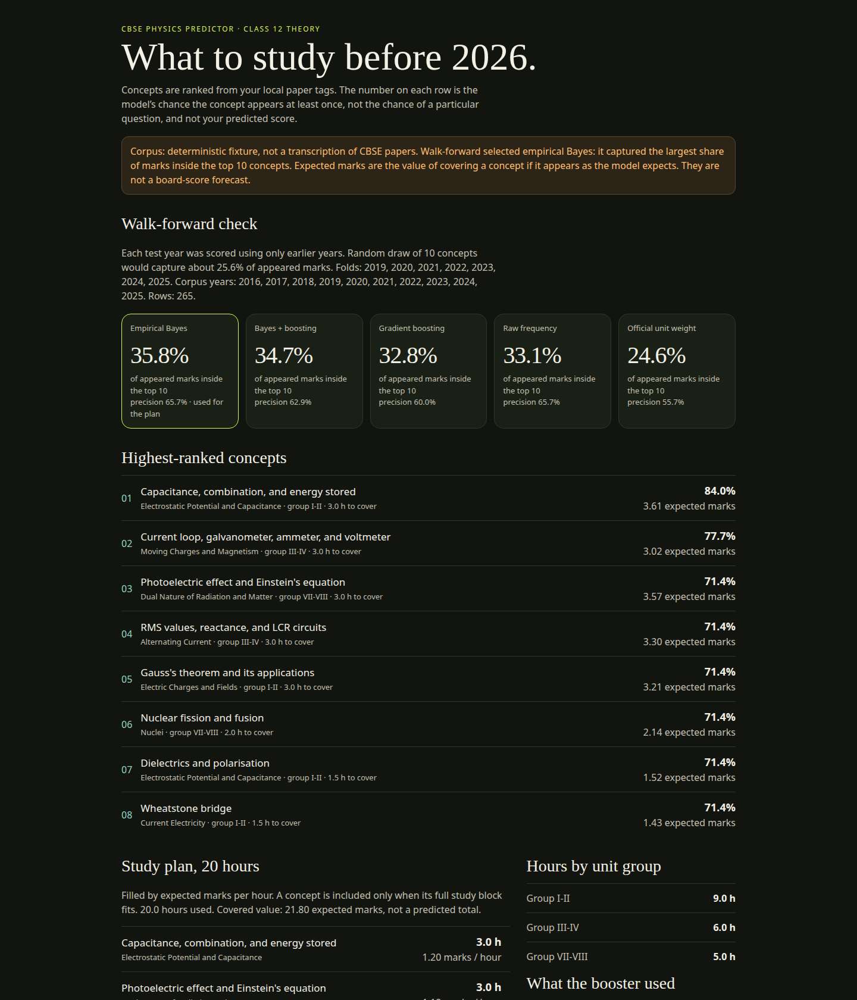
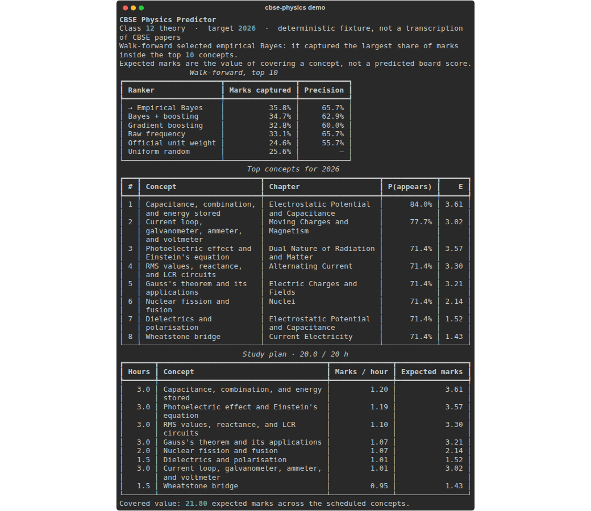

# CBSE Physics Predictor

**Rank the NCERT Class 12 Physics concepts that repay your next hour of study.**

Tag your own question-paper PDFs, shrink the noisy year-to-year rates with empirical Bayes, compare that ranker to gradient boosting in a walk-forward backtest, and turn the winner into an hour-budget plan. It runs offline. It does not see an unpublished paper, and it does not predict your board score.

[](https://github.com/ryaneditraj/cbse-physics-predictor/actions/workflows/ci.yml)
[](LICENSE)
[](https://www.python.org/downloads/)
[](https://cbseacademic.nic.in/web_material/CurriculumMain26/SrSec/Physics_SrSec_2025-26.pdf)

Not affiliated with CBSE or NCERT.

## Demo

These pictures are from `cbse-physics demo` on the bundled fixture, then opened in a browser. The fixture is a simulator, not a set of board papers.





The same page is checked in at [`docs/sample-report.html`](docs/sample-report.html). Regenerate it with `cbse-physics demo --out docs/sample-report.html`.

On that fixture, walk-forward (train only on earlier years, score 2019–2025) put this share of the year's appeared marks inside the top 10 concepts:

| Ranker | Marks in the top 10 | Precision |
| --- | ---: | ---: |
| Empirical Bayes, selected | 35.8% | 65.7% |
| Bayes + boosting blend | 34.7% | 62.9% |
| Gradient boosting | 32.8% | 60.0% |
| Raw frequency | 33.1% | 65.7% |
| Official unit-group weight | 24.6% | 55.7% |
| Uniform draw of 10 concepts | 25.6% | — |

The unit-weight row sits next to random because CBSE publishes five combined totals, not a mark for every concept, and this fixture's signal is which concepts recur. Your PDFs can move every number. Run `cbse-physics backtest` on them before you trust a plan.

## Features

- **NCERT concept tags** for all 14 Class 12 theory chapters, with word-boundary keywords and curly-quote normalization.
- **PDF ingest** that keeps concept ids, a year, and optional marks. Question text stays in memory and is not written to the corpus.
- **Empirical Bayes** shrinkage of hit rates, plus a shallow scikit-learn gradient booster and a half-and-half blend.
- **Walk-forward selection.** The plan uses whichever ranker captured the most marks in the top 10. A tie keeps the simpler Bayes model.
- **Expected-value study plan.** Concepts are scheduled by expected marks per hour until the budget is full. A block that does not fit is skipped, not sliced.
- **HTML report** with the backtest, the ranking, and the plan. It is self-contained, escaped, and marked `noindex`.

## Tech stack

Python 3.11+, scikit-learn (`GradientBoostingClassifier`), a Beta–Binomial empirical Bayes prior implemented in this repo, pypdf, and Rich. Optional OCR uses pytesseract and pdf2image against a local Tesseract. No account, no API key, no hosted model.

Official theory weightage follows the [CBSE Class XII Physics curriculum for 2025-26](https://cbseacademic.nic.in/web_material/CurriculumMain26/SrSec/Physics_SrSec_2025-26.pdf) (code 042, 70 marks). The five combined groups are Electrostatics and current electricity (16), magnetism and alternating current (17), electromagnetic waves and optics (18), dual nature with atoms and nuclei (12), and semiconductor electronics (7).

## Quick start

```bash
git clone https://github.com/ryaneditraj/cbse-physics-predictor.git
cd cbse-physics-predictor
python -m venv .venv
source .venv/bin/activate          # Windows: .venv\Scripts\activate
pip install -e .
cbse-physics demo
```

Open `out/report.html`. The command also prints the tables in the terminal.

```bash
pip install -e ".[dev]"            # pytest and pip-audit
pytest
```

## Usage

Build a corpus from PDFs you have the right to process. One year per run, or read a year out of the file name:

```bash
cbse-physics ingest ./papers/physics-2024.pdf --year 2024 --set 1 --out papers/corpus.jsonl
cbse-physics ingest ./papers --year-from-name --append --out papers/corpus.jsonl
cbse-physics ingest ./papers/physics-2024.pdf --year 2024 --dry-run
```

`papers/` is gitignored. Ingest stores the file's basename, the concept id, and a keyword count. Marks are null until you add them. Null marks fall back to a planning weight on the concept, and the report says how many rows were imputed.

Rank, check, and plan. `--year` defaults to the year after the latest row.

```bash
cbse-physics backtest --corpus papers/corpus.jsonl
cbse-physics predict --corpus papers/corpus.jsonl --year 2027 --top 12
cbse-physics plan --corpus papers/corpus.jsonl --hours 15 --json
cbse-physics report --corpus papers/corpus.jsonl --hours 15 --year 2027 --out out/my-plan.html
```

Omit `--corpus` and the commands use the built-in fixture, so you can try the full loop before you have papers.

Scanned PDFs need the optional extra and a local Tesseract plus Poppler. The project does not read `.env` by itself:

```bash
pip install -e ".[ocr]"
export CBSE_PHYSICS_OCR=1
# export CBSE_PHYSICS_TESSERACT_CMD=/usr/bin/tesseract
cbse-physics ingest ./scans/physics-2023.pdf --year 2023 --out papers/corpus.jsonl
```

If a PDF has a text layer, OCR is not used.

## How a rank is made

For a target year T, every feature is computed from years before T:

- shrunk hit rate and raw hit rate
- how long since the concept last appeared, and whether it appeared in the most recent past year
- hit rate over the last three years
- average marks when it appeared
- the official unit-group share of the 70-mark paper, and that share split evenly across the concepts in the group

Gradient boosting trains on earlier years only, with those same past-only features. The walk-forward fold for 2024 never sees 2024. Expected marks are P(appears) times average marks when it appeared. The study plan sorts by that value divided by a planning-hour weight. Those hours are editorial, not a CBSE timetable.

## Project structure

```text
cbse_physics/
  cli.py            cbse-physics demo | ingest | backtest | predict | plan | report
  taxonomy.py       39 NCERT concepts and the five official mark groups
  tagger.py         keyword tagging
  extract.py        PDF text and optional OCR
  corpus.py         JSONL schema and validation
  models.py         empirical Bayes, gradient boosting, walk-forward
  plan.py           hour budget
  report.py         escaped HTML report
  fixture.py        deterministic demo corpus
  data/fixture_appearances.jsonl
tests/              leakage, tagging, XSS, path, and CLI checks
docs/               project site, sample report, screenshots
.github/            CI, issue forms, pull request template
```

## Roadmap

- A local screen to accept or reject tags before they are written.
- Practical-exam concepts, kept separate from the 70-mark theory paper.
- A calibration plot next to the walk-forward table.
- A wheel on PyPI. Until then, install from this clone.

## FAQ

### What does this CBSE Physics predictor actually predict?

It ranks NCERT concepts by how likely they are to appear at least once in a target year, given the tagged papers you supply. It also estimates the marks those appearances have been worth. It does not predict a specific question, a set number, or your final percentage.

### Does it leak or reconstruct the upcoming board paper?

No. The ranker only sees years before the one it is scoring. An unpublished paper is invisible to it. If the year you ask for is already in the corpus, the command says so and still trains only on earlier years.

### Which class and subject does it cover?

CBSE Class 12 Physics theory, chapters 1 through 14 of the NCERT textbook, aligned to the 2025-26 curriculum (code 042). Class 11 and the practical exam are out of scope.

### How do I use my own previous-year question paper PDFs?

`cbse-physics ingest` with `--year` or `--year-from-name`. Check the printed concept ids. Wrong tags are keyword misses. Fix them in `cbse_physics/taxonomy.py` and add a test with a sentence you wrote yourself. Do not commit the PDF.

### What is a walk-forward backtest, and why is it here?

Each past year is scored as if it were still in the future. The model that captured the most marks inside the top 10 concepts is the one the plan uses. That is there so a prettier model cannot win on a story. On the fixture, the simpler Bayes model beat gradient boosting.

### How is the study plan's expected value calculated?

For each concept, expected marks equal the probability it appears times the average marks when it has appeared. Divide by the concept's study-hour weight. Fill the budget with the highest values that still fit. The total is the value of covering those concepts, not a forecast of your score.

### Is the bundled data real CBSE papers?

No. `fixture_appearances.jsonl` is generated by `cbse_physics/fixture.py` from a fixed random seed, official group weights, and a rotating emphasis chapter. It exists so the demo and the tests run offline. The report banner says so.

### Do I need an API key or an internet connection?

No. Training is local. OCR, if you turn it on, is a local binary. Nothing in this repository is a credential.

### How accurate is it?

On the fixture, empirical Bayes captured 35.8% of appeared marks in the top 10, against 25.6% for a random 10 concepts, over the years 2019–2025. That is a real run of this code, and it is only a statement about the fixture. A short corpus, or a corpus with bad tags, can do worse. Read the backtest for the file you pass in.

### Can it read a scanned question paper?

Yes, if you install the `ocr` extra, set `CBSE_PHYSICS_OCR=1`, and have Tesseract and Poppler installed. Text PDFs never go through OCR. The tesseract path cannot contain shell syntax.

### Is this affiliated with CBSE or NCERT?

No. Chapter names and the combined mark groups follow the public curriculum. The boards did not review this project.

### What Python version do I need?

Python 3.11 or 3.12. CI tests both.

### How do I correct a bad concept tag?

Open a [concept tag issue](.github/ISSUE_TEMPLATE/concept_tag.yml) with a sentence you wrote yourself, or send a pull request with a test. Please do not paste board-paper wording.

## Contributing

See [CONTRIBUTING.md](CONTRIBUTING.md). Issues use the forms in `.github/ISSUE_TEMPLATE/`. Be kind. The [Code of Conduct](CODE_OF_CONDUCT.md) applies.

## Security

[SECURITY.md](SECURITY.md) describes how to report a vulnerability and what the CLI refuses to do. No secret has been committed in this repository.

## License

[MIT](LICENSE). Copyright 2026 Ryan Editraj.

## Author

**Ryan Editraj** — AI builder and tech creator.

- GitHub: [github.com/ryaneditraj](https://github.com/ryaneditraj)
- Instagram: [instagram.com/ryaneditraj](https://instagram.com/ryaneditraj)
